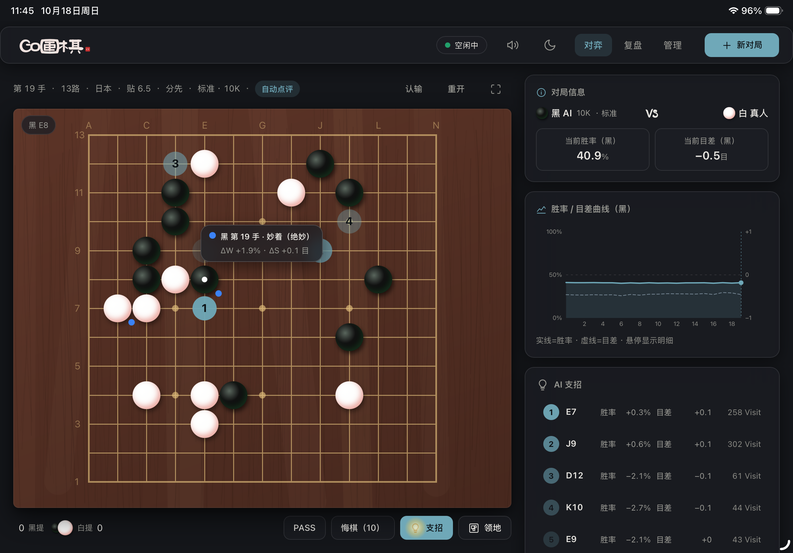
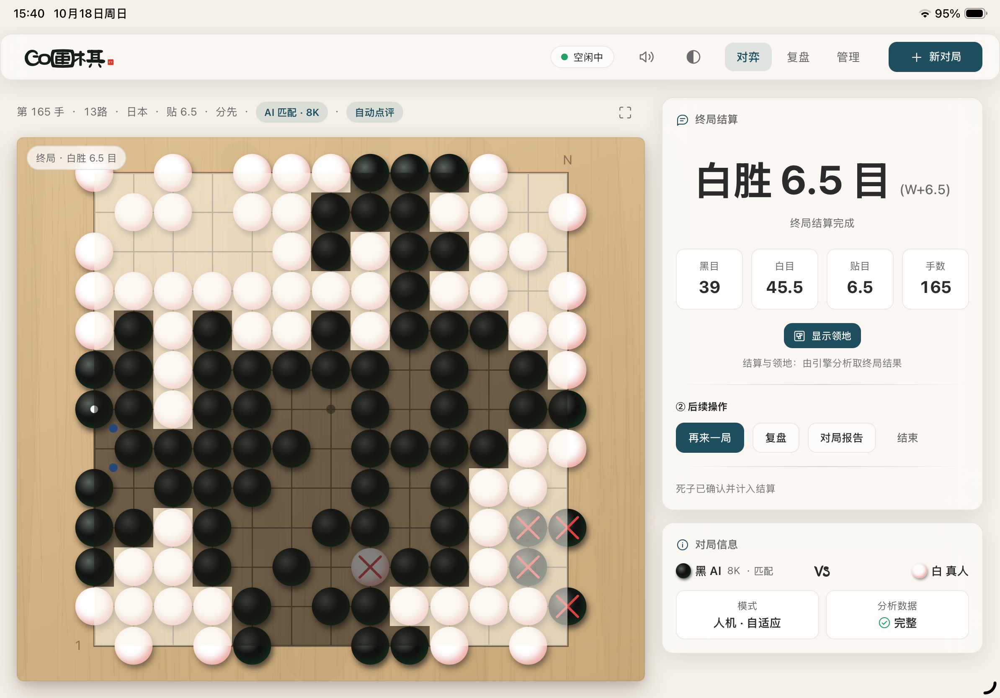

# tGo · 围棋对弈与复盘平台

> **装在一台电脑/服务器上，家里人的手机、平板、电脑打开浏览器就能随时下棋与复盘。**

tGo 是一个运行在你自己电脑/服务器上的围棋网站：它与职业水平的围棋 AI（KataGo）配合，提供人机对弈、实时支招、逐手点评和棋局复盘。**不用注册账号，不用安装手机 App，棋谱和设置都保存在你自己的电脑/服务器里。**




上手只需三步：① 准备好项目文件夹 → ② 把 AI 引擎和模型放进指定文件夹 → ③ 双击启动程序，浏览器会自动打开。

**本 README 章节**：1 tGo 解决哪些困扰 ｜ 2 功能一览 ｜ 3 部署前的准备 ｜ 4 三步完成部署 ｜ 5 引擎与模型简明指南 ｜ 6 参数调整 ｜ 7 常见问题 ｜ 8 目录说明 ｜ 9 更多资料 ｜ 10 开源许可 ｜ 11 赞助支持

---

## 1. tGo 解决哪些困扰

| 围棋爱好者的常见困扰 | tGo 的做法 |
| --- | --- |
| 想下棋，却找不到水平合适的对手 | 人机对弈提供 **12 档棋力**（20K 启蒙 ~ 9D 顶尖）任选；打开 **自适应难度** 后，AI 还会跟着你的实际发挥自动调整强弱 |
| AI 太强，被压着打，越下越没兴趣 | 低难度下 AI 会留有余地；**仿人类风格**让 AI 下得像真人（有自己的棋风，也会犯合理的错），更像陪练 |
| 输了，却不知道输在哪一手 | 每一手都有 **AI 点评**（妙着 / 正着 / 缓着 / 失误 / 败着，用颜色区分）；**胜率与目差曲线**把整盘棋的起伏完整画出来 |
| 复盘软件装起来太麻烦，参数看不懂 | **一键启动**、全中文界面；AI 强度、线程、常驻等设置都在网页「管理」页里点选，不需要敲命令 |
| 想在手机、平板上看棋或下棋 | 局域网内同一个网址，手机、平板、电脑都能用，棋局实时同步 |
| 研究变化图时，怕把原谱弄乱 | **试下模式**：在任意一手自由摆变化，分支独立保存，随时「回实战」继续 |
| 电脑重启或换台设备，棋局就丢了 | **断点续弈**：每一步都自动保存，刷新页面、换设备、服务重启后都能接着下 |
| 家人、朋友想在同一台设备上下棋 | **人人对弈（热座）**：同屏轮流落子，自动判断轮到哪一方 |
| 想调显卡、调参数，心里没底 | 自动识别显卡，**管理页显示 AI 引擎的实时状态**；首次使用显卡会自动调优并显示进度；显存不够也有对应的调整项 |
| 棋谱想留档、想发给别人 | 支持 **导出 / 导入 SGF** 通用棋谱格式，历史对局可以搜索、筛选、收藏 |

除了功能，tGo 也讲究“安静地下棋”：东方水墨气质搭配毛玻璃质感界面、浅色/深色主题、落子与吃子的音效动画，还可以一键进入 **沉浸模式**（全屏只剩棋盘）。

---

## 2. 功能一览

| 模块 | 主要能力 |
| --- | --- |
| 对弈 | 人机 / 人人；9、13、19 路；中国规则（默认）；贴目与让子；AI 难度、仿人类风格、自适应难度；创建对局时可录入姓名与段位（下次自动带出） |
| 陪练 | AI 支招（TOP5 推荐点按胜率着色，可点开看后续变化图）；胜率与目差曲线；逐手点评与恶手提示；领地与终局预判；悔棋 / PASS / 认输 / 重开 |
| 结算 | 自动数子、显示领地范围、确认终局结果，并可「再来一局」「去复盘」「看对局报告」 |
| 复盘 | 棋谱列表（按姓名搜索、按对局编号定位、筛选进行中/已结束、收藏、导出、删除）；导入 SGF 棋谱；逐手回放并与曲线联动 |
| 研究 | 试下分支与变化图；深度分析；全局补分析；对局报告（AI 吻合度、平均目数损失、落子质量分布、胜负手、棋力评估） |
| 管理 | 引擎启动/停止与状态监控；常驻或空闲自动释放；切换标准模型；调整分析强度与线程；从官方源下载引擎与模型；查看主机与显卡信息；运行日志；检查并安装新版本 |

---

## 3. 部署前的准备

| 项目 | 要求 | 说明 |
| --- | --- | --- |
| 一台电脑 | Windows 10/11，或 Debian 系 Linux | 作为“主机”长期开着，局域网内的其它设备即可访问；也可以就用你日常使用的电脑 |
| Python | **3.10 或更高版本** | 只需安装一次；Windows 安装界面务必勾选 **Add Python to PATH** |
| 显卡（可选） | 支持 OpenCL 的常见显卡 | 有显卡才能使用 AI 对弈与分析；没有也可以装，人人对弈与复盘照常，详见第 5 章 |
| 内存 | 建议 8 GB 以上 | AI 的内存占用会随使用逐步增长，不会一次性占满 |
| 硬盘空间 | 约 2 GB 富余 | 运行环境约 250 MB + 两个模型约 180 MB |
| 浏览器 | 常见的现代浏览器 | 电脑、平板、手机都可以，无需安装任何客户端 |
| 网络 | 家庭 / 局域网内互通 | ⚠️ 仅供可信网络使用：**不要直接暴露到公网**（本系统没有账号密码） |

---

## 4. 三步完成部署

### 第 1 步：准备项目文件夹

把项目文件放在一个固定的目录（例如 `D:\tGo`），之后不要随意移动或改名。

### 第 2 步：放入引擎与模型

AI 需要一个“引擎程序”和一个“下棋大脑”（模型）。如果拿到的安装包里 `engine` 文件夹内已经有这些文件，可跳过本步；否则按第 5 章的说明下载并放入：

```text
engine/katago/    ← 引擎程序（Windows：katago.exe 以及同目录的全部 dll；Linux：katago）
engine/models/    ← 模型文件（文件名以 .bin.gz 结尾）
```

> 引擎或模型缺失不会导致启动失败：**人人对弈、复盘、导入导出棋谱等不需要 AI 的功能照常使用**，页面会明确提示缺什么。
>
> 也可以先完成第 3 步启动服务，再到「管理」页「版本与资源」卡片里直接下载引擎与模型（需主机能访问外网）。

### 第 3 步：一键启动

**Windows**：双击 `start.bat`（若被系统拦截，可右键 `start.ps1` 选择“使用 PowerShell 运行”）。

首次启动会自动检查文件完整性、准备好运行环境并打开浏览器；以后重复双击不会重复安装。启动窗口大致如下：

```text
[tGo] ============================================================
[tGo]   tGo 一键启动（Windows · start.ps1）
[tGo] ============================================================
[tGo] [1] 文件与环境预检（required-files.txt 全量清单）…
[tGo] [1] 通过：共校验 115 项运行文件
[tGo] [2] 依赖已是最新（跳过安装）：Python 3.14 @ backend/.venv
[tGo] [3] 启动服务（Ctrl+C 停止）…
[tGo] ============================================================
[tGo]   tGo Server
[tGo]   - Local    : http://127.0.0.1:8090/
[tGo]   - LAN      : http://192.168.3.7:8090/
[tGo] ============================================================
```

其中 **LAN 那一行就是局域网地址**，手机、平板、其它电脑在浏览器里输入它即可使用。

**Linux**：

```bash
chmod +x deploy.sh
./deploy.sh                    # 一键部署：检查文件 → 准备运行环境 → 安装所需组件
./deploy.sh run --open         # 前台运行，并自动打开浏览器
./deploy.sh install --service  # 安装成开机自启的后台服务（需要 sudo）
./deploy.sh upgrade            # 更新到新版本（保留你的设置与棋谱）
./deploy.sh help               # 查看全部命令
```

**使用与停止**：

- **访问**：同一 WiFi 下的设备打开 LAN 地址即可；若 Windows 首次弹出防火墙询问，请选择“允许专用网络”。
- **停止**：在启动窗口按 **一次** `Ctrl+C` 优雅退出（要给进行中的对局留出收尾时间，请耐心等几秒，**不要连按两次**）。安装成系统服务时用 `./deploy.sh service stop`。
- **重复启动是安全的**：若服务已经在运行，再次双击只会打开浏览器，不会启动第二个副本；此时在窗口按 `S` 再按 `Y`，可以直接停掉正在运行的那个副本。
- **端口**：默认 `8090`；若被其它程序占用会自动改用 8091、8092 ……，**一切以窗口显示的地址为准**。

### 使用 Docker 部署（Linux / NAS，可选）

如果你熟悉 Docker，也可以把 tGo 作为容器运行。镜像**不含**引擎和模型，二者通过宿主机目录挂载：

1. **准备发布包**：`tGo-Setup/` 既是部署目录，也是镜像构建上下文。若该目录不存在或不是当前版本，先在项目根目录执行：

   ```powershell
   powershell -ExecutionPolicy Bypass -File tools\make-setup.ps1
   ```

2. **放入引擎与模型**：在 `tGo-Setup/` 中放入 **Linux 版** `engine/katago/katago` 与 `engine/models/*.bin.gz`（Windows 的 `katago.exe` 不能用于容器）。

3. **构建并导出镜像**：在安装了 Docker Desktop（Linux 容器模式）的 Windows 电脑上，于项目根目录执行：

   ```powershell
   powershell -ExecutionPolicy Bypass -File tools\docker-build.ps1
   # 生成 tgo-latest.tar.gz；将此文件与 tGo-Setup 一起拷到 NAS / Linux 主机
   ```

4. **导入并启动**：在 x86_64 的 NAS / Linux 主机上执行：

   ```bash
   docker load -i tgo-latest.tar.gz
   cd tGo-Setup
   docker compose up -d
   docker compose logs -f
   ```

5. **访问**：浏览器打开 `http://<主机 IP>:8090/`。设置、棋谱、日志分别在 `config/`、`data/`、`logs/`，都保存在宿主机上。若 8090 已被占用，可用 `TGO_HTTP_PORT=9090 docker compose up -d` 只改对外端口。

> 说明：KataGo 官方 Linux 发行包是 AppImage，镜像已启用 `APPIMAGE_EXTRACT_AND_RUN=1`（extract-and-run），无需安装 FUSE 或授予 `SYS_ADMIN`。KataGo 的 Linux 构建仅支持 x86_64，ARM 主机只能使用人人对弈与复盘。

---

## 5. 引擎与模型简明指南

> 只想下棋和复盘？本章只需看 **5.4 获取引擎与模型**；想微调性能再看 5.5、5.6 与第 6 章。

### 5.1 引擎是什么

**KataGo** 是目前最强的开源围棋 AI 之一。它本身没有界面，只负责“思考”；tGo 负责界面、对局流程和棋谱保存，把每一个局面交给它计算。tGo 启动时会把它作为常驻的分析引擎使用：一边下，一边算。

### 5.2 引擎的“后端类型”：决定它靠什么来算

下载引擎时你会看到多个版本，区别只是“用哪种方式调用硬件”：

| 后端 | 适合谁 | 说明 |
| --- | --- | --- |
| **OpenCL**（推荐） | 几乎所有显卡（NVIDIA / AMD / Intel），也可用 CPU | 通用性最好，装好显卡驱动就能跑；速度略慢于 CUDA |
| CUDA | NVIDIA 显卡 | 需要额外安装 NVIDIA 的 CUDA 组件，速度更快 |
| TensorRT | 较新的 NVIDIA 显卡 | 速度最快，但更吃显存，配置也相对复杂 |
| ROCm | AMD 显卡（仅 Linux） | AMD 显卡专用 |
| Eigen | 没有可用显卡 | 纯 CPU 计算，速度很慢，只适合试玩 |

**怎么选**：先用 **OpenCL** 版本；用起来正常就不必更换。管理页会显示引擎实际使用的后端类型。

### 5.3 模型的类型：标准模型 与 人类模型

| 模型 | 作用 | 文件名特征 | 是否必需 |
| --- | --- | --- | --- |
| **标准模型** | 追求最强棋力的“大脑”，负责 AI 对弈以及全部分析（胜率、目差、支招、点评、报告） | 形如 `kata1-b18c384nbt-…….bin.gz` | **必需**（否则 AI 功能不可用） |
| **人类模型** | 让 AI 下得更像人类（有棋风、也会犯合理的错），供“仿人类风格”和“自适应难度”使用 | 文件名含 `human`，如 `b18c384nbt-humanv0.bin.gz` | 可选（缺失时只有标准风格可用） |

- 想要**最强棋力**：选最新/Elo 分最高的标准模型。
- 想要**陪练手感**：再放入一个人类模型，创建对局时选择“仿人类风格”。

### 5.4 获取引擎与模型（管理页下载 / 手动放置）

**方式一：管理页下载（推荐）**

打开网页左侧「管理」→「版本与资源」卡片：

| 要做的事 | 操作 | 说明 |
| --- | --- | --- |
| 安装 / 升级 KataGo 引擎 | 选择「引擎版本」与「构建 / 后端」→「下载并安装 KataGo」 | 构建列表自动按当前平台过滤，默认推荐 OpenCL；安装前会停止引擎，保留你的 `analysis.cfg`，若引擎原本在运行，安装后自动重启 |
| 下载标准模型 | 在「标准模型」下拉中选择 →「下载标准模型」 | 列表来自 katagotraining.org（前 30 个），标注 Elo、最新/最强，并提示与当前引擎是否兼容 |
| 下载人类模型 | 「下载人类模型」 | 固定为官方 `b18c384nbt-humanv0.bin.gz` |

- 下载源为 KataGo 官方 GitHub Releases 与 katagotraining.org，需要主机能访问外网（代理 / 防火墙请放行）。
- 进度显示在卡片内；同一时间只执行一个下载或更新任务。
- **模型下载后不会自动启用**：请到「引擎 / 模型」卡将其设为默认并重启引擎（见 5.5）。
- Docker 部署同样可以在页面内下载，文件写入挂载的 `engine/` 目录。

**方式二：手动下载**

| 需要的东西 | 官方下载网址 | 存放位置 |
| --- | --- | --- |
| 引擎程序 KataGo | <https://github.com/lightvector/KataGo/releases> （选带 `opencl` 且与你系统相符的包，如 `...-opencl-windows-x64.zip` / `...-opencl-linux-x64.zip`） | 解压后，把可执行文件与同目录的**全部文件**一起放进 `engine/katago/` |
| 标准模型（最强棋力） | <https://katagotraining.org/> （选择最平衡、最新或 Elo 分最高的网络） | 整个 `.bin.gz` 文件直接放进 `engine/models/` |
| 仿人类模型 | <https://github.com/lightvector/KataGo/releases/tag/v1.15.0> （下载 `b18c384nbt-humanv0.bin.gz`） | 同上 |
| 更早 / 更多标准模型 | <https://katagoarchive.org/> | 同上 |

手动放置要点：

- **引擎**：Windows 解压后会有一堆 `.dll`，它们必须和 `katago.exe` 放在一起（不要只复制 exe）；Linux 需要给可执行文件加上可运行权限，从 Windows 拷贝或解压过来经常会丢掉——一键脚本会自动补上并自检提示。
- **模型**：`*.bin.gz` 文件**不需要解压**，直接放进 `engine/models/`。

### 5.5 标准模型的选择（有多个模型时）

- `engine/models/` 里可以放**多个**标准模型，「管理」页的模型卡片中可选择**默认使用哪一个**，保存后系统会安全重启引擎使其生效。
- 也可以在 `config.yaml` 中指定 `engine.standard_model`（文件名）与 `engine.human_model`；不填则自动挑选（人类模型会自动找文件名含 `human` 的那个）。
- 人类模型只需要一个，无需选择。

### 5.6 首次启动会“调优”，属正常现象

第一次让引擎使用某块显卡或者变更模型时，它会自动测试并记住最快的运行方式，通常需要几秒到几分钟，进度会显示在页面上（类似 `Tuning …`）。调优结果会被缓存，**之后再启动就是秒开**。这段时间不影响人人对弈与复盘。

---

## 6. 参数调整（想改什么，改哪里）

绝大多数设置都能在网页的「管理」页完成；下面是常用项的对照表。

| 想达到的效果 | 在哪里改 | 说明 |
| --- | --- | --- |
| 让 AI 算得更强（曲线、点评更准） | 管理页的「参数」，或 `config.yaml` 的 `engine.standard_max_visits` | 默认 100，调大更准也更慢 |
| 让「深度分析」更强 | `config.yaml` 的 `engine.deep_max_visits` | 默认 800，必须大于标准分析强度 |
| 让多核电脑跑得更快（或少抢 CPU） | 管理页的「参数」，或 `engine.num_analysis_threads`、`engine.num_search_threads_per_analysis_thread` | 默认 2 × 16；改动后引擎会自动安全重启 |
| 让 AI 随开随用、不用等待 | 管理页的「引擎常驻」开关，或 `engine.resident: true` | 常驻会持续占用一部分显卡与内存 |
| 不用 AI 时自动释放显卡 | 关闭常驻（默认），并设置空闲时间 `engine.idle_timeout_s` | 默认 1800 秒；空闲即自动释放，下次需要时自动拉起 |
| 换了引擎或模型的位置 | `engine.executable_dir`、`engine.model_dir`、`engine.standard_model`、`engine.human_model` | 按相对项目目录填写 |
| 显存不够（引擎报错或启动失败） | 编辑 `engine/katago/analysis.cfg` 中的 `nnMaxBatchSize` | 默认 64，改小（如 32、16）后重启引擎 |
| 内存占用偏高 | 编辑 `engine/katago/analysis.cfg` 中的 `nnCacheSizePowerOfTwo` | 数值越大越占内存，且随使用逐步增长 |
| 换一个访问端口 | `config.yaml` 的 `server.port` | 默认 8090；被占用会自动改用下一个 |
| 默认棋盘大小、贴目、规则、悔棋上限 | `config.yaml` 的 `play` 一段 | 也可以在创建对局时临时选择 |

- `config.yaml` **只需写与默认不同的项**，其余保持自动；升级时这个文件会被保留。
- `engine/katago/analysis.cfg` 是引擎自己的参数文件，**你对它的修改不会被程序覆盖**（程序只维护线程数等少数几项）。改完到管理页重启引擎生效。
- 多显卡机器想指定用哪块显卡：在 `engine/katago/analysis.cfg` 中追加一行 `openclGpuToUse = 0`（0 表示第一块）。
- 换模型时请确认**模型与 KataGo 版本配套**：老版本引擎打不开新模型（日志会出现 `requires a newer KataGo version … Model version: N`），此时换模型也起不来——需要换成配套的模型，或升级 `engine/katago/` 下的引擎文件。

---

## 7. 常见问题

| 现象 | 处理办法 |
| --- | --- |
| 手机 / 平板打不开页面 | 确认与主机在同一个 WiFi；Windows 首次运行请允许防火墙的“专用网络”；地址要使用启动窗口里的 LAN 地址 |
| 页面提示「引擎不可用 / 标准模型缺失」 | 检查 `engine/katago/`（是否漏放 dll）与 `engine/models/` 中文件是否就位；放好后到管理页点「重启引擎」，不必重启整个程序 |
| 管理页下载引擎 / 模型失败 | 确认主机能访问 GitHub 与 katagotraining.org（代理、防火墙）；也可按第 5.4 节手动下载后放入 `engine/` 目录 |
| 首次启动很久没有动静 | 显卡首次调优需要一些时间，进度会显示在页面上；之后启动很快 |
| 引擎崩溃或反复报错 | 系统会自动尝试恢复，频繁失败会在页面提示；到管理页查看具体原因（常见是模型缺失或显存不足），也可手动「重启引擎」 |
| 换了模型还是起不来（提示 `requires a newer KataGo version … Model version: N`） | 模型与 KataGo 版本不配套（见第 6 章末尾的换模型提示）：换成配套模型，或升级 `engine/katago/` 下的引擎文件；此时继续切换模型不会解决问题 |
| 显存不足的报错 | 把 `engine/katago/analysis.cfg` 中的 `nnMaxBatchSize` 调小 |
| 没有独立显卡 / 暂时不想用 AI | 照常使用：人人对弈、复盘、棋谱导入导出都不受影响 |
| 提示端口被占用 | 无需处理，系统会自动换到下一个端口，以启动窗口显示的地址为准 |
| 关掉启动窗口后打不开了 | 关闭窗口就等于停止服务，重新双击 `start.bat` 即可；希望它在后台长期运行，Linux 可执行 `./deploy.sh install --service` |
| 想备份棋谱与设置 | 复制 `data/`（棋谱数据库）与 `config.yaml` 即可；升级不会覆盖它们 |
| 想升级到新版本 | 用新版本文件覆盖项目目录后重新双击 `start.bat`（Linux：`./deploy.sh upgrade`）；也可在管理页「版本与资源」中检查更新。Docker 部署请重建镜像，见第 4 章 |
| 想确认当前版本 | 管理页「版本与资源」卡片显示当前版本、引擎版本与可用更新 |
| 想彻底卸载 | 关闭启动窗口，然后删除整个项目文件夹 |

> 安全提示：tGo 没有账号与密码，请只在**可信的家庭 / 局域网**内使用，不要直接暴露到公网。

---

## 8. 目录说明

| 路径 | 说明 |
| --- | --- |
| `start.bat` / `start.ps1` | Windows 一键启动 |
| `deploy.sh` / `tgo.service` | Linux 一键部署脚本，以及开机自启服务的模板 |
| `config.yaml` | **你的设置**（只写与默认不同的项；升级时保留） |
| `engine/katago/` | 引擎程序，以及引擎参数文件 `analysis.cfg`（你的修改不会被覆盖） |
| `engine/models/` | 模型文件（`.bin.gz`） |
| `data/` | 棋谱数据库（你的对局数据，建议定期备份） |
| `logs/` | 运行日志（自动轮转，便于排查问题） |
| `backend/`、`frontend/` | 程序本体；运行环境在首次启动时自动准备，无需手工改动 |
| `required-files.txt` | 启动前的文件完整性清单（缺文件会明确提示） |
| `tools/make-setup.ps1` | 制作安装包用，日常使用无需关心 |
| `docker-compose.yml`、`tools/Dockerfile`、`tools/docker-build.ps1` | Docker 部署用 |

---

## 9. 更多资料

| 文档 | 内容 |
| --- | --- |
| [DEPLOYMENT.md](./DEPLOYMENT.md) | 部署方式、配置项、显存调优、升级与故障排查 |
| [CHANGELOG.md](./CHANGELOG.md) | 版本变更记录 |
| [LEVEL.md](./LEVEL.md) | tGo 业务逻辑相关约定 |
| [default.yaml](./backend/default.yaml) | tGo 应用默认配置参数及注解 |

---

## 10. 开源许可

tGo 以 **GNU General Public License v3.0（GPL-3.0）** 发布，完整条款见 [LICENSE](./LICENSE)。

Copyright (C) 2026 tGo contributors.

你可以自由使用、研究、修改和分发本软件；如果分发修改后的版本，请遵守 GPL-3.0 的开源义务，并保留版权与许可声明。本软件按“现状”提供，不附带任何明示或默示担保。

> KataGo 引擎与模型有各自的许可证，详见其官方仓库；tGo 的 GPL-3.0 不改变这些上游组件的授权。

---

## 11. 赞助支持

tGo 由独立开发者利用业余时间维护。如果它帮你省下了找棋友、装复盘软件或整理棋谱的时间，欢迎自愿支持项目继续迭代。

- **入口**：管理页顶栏的「添盏清茶」，长按 3 秒即可打开赞助卡片；
- **方式**：支持微信 / 支付宝，提供 8 元「清茶」与 18 元「浓茶」两档；
- **原则**：赞助完全自愿，不影响任何功能的可用性，也不提供付费解锁、优先支持或其他附加权益；
- **资源**：收款二维码从项目仓库远程加载，不随软件发布包分发。

感谢每一位使用、反馈和赞助 tGo 的棋友。

---

**致谢**：tGo 的棋力与分析能力来自开源项目 [KataGo](https://github.com/lightvector/KataGo) 及 [KataGo 分布式训练计划](https://katagotraining.org/)。感谢作者与社区的无私贡献，使用时请遵守其许可与使用条款。
